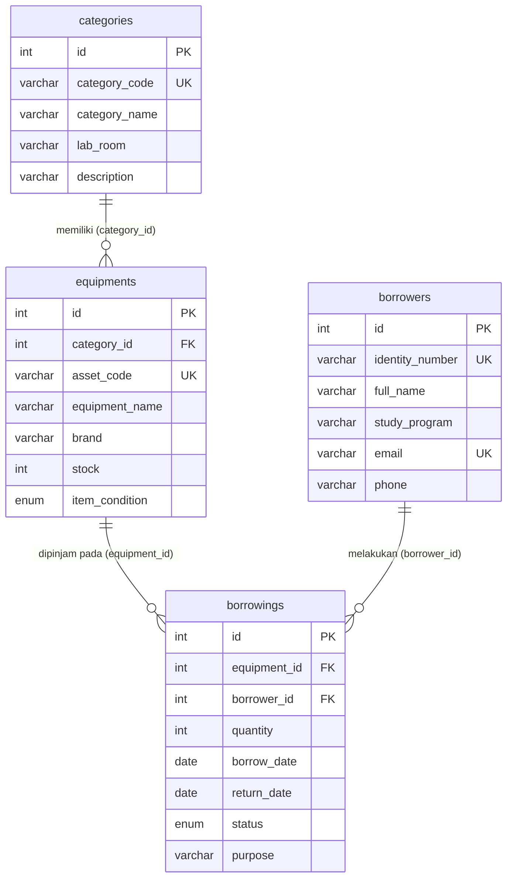
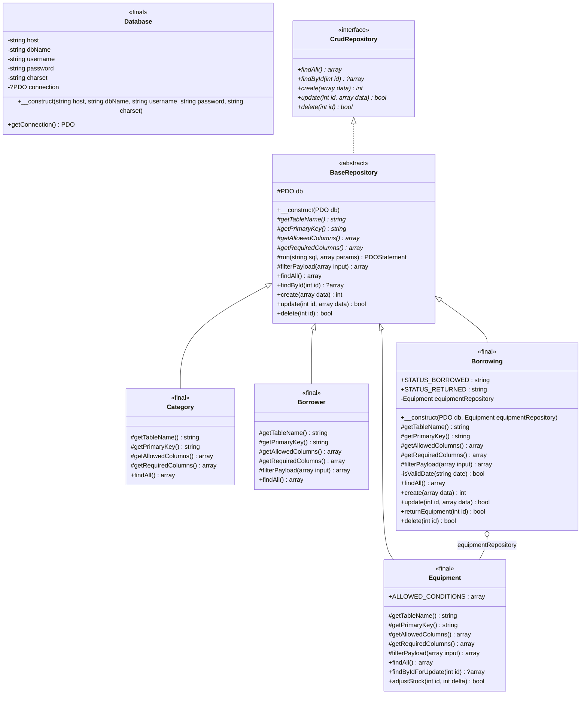

# TP7 DPBO — Sistem Manajemen Peminjaman Alat Laboratorium Komputer (LabGear)

## Janji

> Saya **Muhammad Fadey Rafif** dengan NIM **2504792** mengerjakan Tugas Praktikum 7 dalam mata kuliah Desain dan Pemrograman Berorientasi Objek untuk keberkahanNya maka saya tidak melakukan kecurangan seperti yang telah dispesifikasikan. Aamiin.
---

## Tema Website & Daftar Fitur Utama

- **Tema Website**: Sistem Inventaris dan Peminjaman Alat Laboratorium Komputer (**LabGear Management System**).
- **Fitur Utama**:
  1. **CRUD Kategori Alat (`categories`)**: Mengelola kategori perangkat laboratorium beserta kode kategori, lokasi ruang lab, deskripsi, dan perhitungan otomatis jumlah jenis alat di tiap kategori.
  2. **CRUD Alat Laboratorium (`equipments`)**: Mengelola inventaris alat laboratorium yang berelasi ke tabel kategori (`category_id`), lengkap dengan kode aset unik, merek, jumlah stok tersedia, dan status kondisi alat (`Baik`, `Perlu Kalibrasi`, `Rusak Ringan`).
  3. **CRUD Data Peminjam (`borrowers`)**: Mengelola data mahasiswa/dosen/asisten peminjam beserta nomor identitas (NIM/NIP), program studi, email, nomor telepon, dan indikator jumlah pinjaman aktif.
  4. **CRUD Transaksi Peminjaman & Pengembalian (`borrowings`)**:
     - Mencatat peminjaman alat dengan relasi ke tabel `equipments` dan `borrowers`.
     - **Sinkronisasi Stok Otomatis & Transaksional**: Saat alat dipinjam, stok pada tabel `equipments` otomatis berkurang di dalam transaksi database (`beginTransaction`, `SELECT ... FOR UPDATE`, `commit`/`rollBack`).
     - **Tombol Kembalikan Cepat**: Mengubah status peminjaman dari `Dipinjam` menjadi `Dikembalikan`, mengisi tanggal kembali otomatis ke hari ini, dan mengembalikan stok alat.
     - **Proteksi Relasi & Validasi**: Menolak peminjaman jika stok tidak mencukupi dan menolak penghapusan data induk (`categories`, `equipments`, `borrowers`) yang masih digunakan oleh tabel anak (`ON DELETE RESTRICT`).

---

## Struktur Project

```text
TP7DPBO2526C1/
├── index.php                  # Titik awal aplikasi, whitelist router (?page=), & Dependency Injection
├── config/
│   ├── bootstrap.php          # Inisialisasi session, load config/helper, dan spl_autoload_register
│   ├── database.php           # Class Database untuk koneksi tunggal PDO (ERRMODE_EXCEPTION, EMULATE_PREPARES=false)
│   └── helpers.php            # Fungsi helper escape HTML e(), flash message PRG, redirect, & translasi error PDO
├── class/
│   ├── CrudRepository.php     # Interface kontrak dasar CRUD (findAll, findById, create, update, delete)
│   ├── BaseRepository.php     # Abstract class CRUD generik dengan PDO Prepared Statement & whitelist kolom
│   ├── Category.php           # Class entitas tabel categories
│   ├── Equipment.php          # Class entitas tabel equipments (+ penguncian baris & penyesuaian stok)
│   ├── Borrower.php           # Class entitas tabel borrowers
│   └── Borrowing.php          # Class entitas tabel borrowings (+ transaksi sinkronisasi stok)
├── view/
│   ├── header.php             # Elemen modular navigasi atas dan penampil flash message
│   ├── footer.php             # Elemen modular penutup halaman
│   ├── categories.php         # Halaman GUI form & tabel CRUD Kategori Alat
│   ├── equipments.php         # Halaman GUI form & tabel CRUD Alat Laboratorium
│   ├── borrowers.php          # Halaman GUI form & tabel CRUD Data Peminjam
│   └── borrowings.php         # Halaman GUI form & tabel CRUD Transaksi Peminjaman
├── style/
│   └── style.css              # Styling halaman responsif untuk form, tabel, badge, dan alert
├── database/
│   └── db_lab_gear.sql        # Struktur DDL 4 tabel (InnoDB, utf8mb4, FK) + data awal yang konsisten
└── README.md                  # Dokumentasi lengkap proyek
```


## Database

### Entity-Relationship Diagram (ERD)



### Penjelasan Tabel dan Foreign Key

| Nama Tabel | Primary Key | Foreign Key & Aturan Relasi | Fungsi Tabel |
| :--- | :--- | :--- | :--- |
| `categories` | `id` | - | Menyimpan data kategori peralatan dan lokasi ruang laboratorium. |
| `equipments` | `id` | `category_id` -> `categories(id)` (`ON DELETE RESTRICT ON UPDATE CASCADE`) | Menyimpan daftar inventaris alat laboratorium, merek, kondisi, dan stok saat ini. |
| `borrowers` | `id` | - | Menyimpan data anggota peminjam (mahasiswa/dosen/asisten) beserta identitas dan kontak. |
| `borrowings` | `id` | `equipment_id` -> `equipments(id)` (`ON DELETE RESTRICT ON UPDATE CASCADE`)<br>`borrower_id` -> `borrowers(id)` (`ON DELETE RESTRICT ON UPDATE CASCADE`) | Menyimpan transaksi peminjaman alat, jumlah unit dipinjam, tanggal pinjam/kembali, status, dan keperluan. |

---

## Class Diagram & Prinsip OOP (SOLID)

### Class Diagram



### Alasan Pemilihan Kelas dan Atribut

| Nama Kelas | Alasan Pemilihan Kelas & Atribut |
| :--- | :--- |
| `Database` | Memisahkan konfigurasi dan pembuatan objek koneksi `PDO` (`$host`, `$dbName`, `$username`, `$password`, `$charset`, `$connection`) agar tidak tercampur dengan logika bisnis tabel. |
| `CrudRepository` | Menyediakan kontrak antarmuka standar (`findAll`, `findById`, `create`, `update`, `delete`) sehingga semua repository memiliki perilaku dasar yang seragam. |
| `BaseRepository` | Menghilangkan duplikasi kode CRUD pada setiap tabel. Menyimpan referensi `$db` (`PDO`) dan mengeksekusi seluruh query hanya melalui method `#run()` yang selalu memakai `prepare()` dan `execute()`, serta memvalidasi kolom lewat whitelist `#filterPayload()`. |
| `Category` | Mengontrol tabel `categories` dengan mendefinisikan whitelist kolom (`category_code`, `category_name`, `lab_room`, `description`) serta meng-override `findAll()` untuk menghitung jumlah jenis alat per kategori. |
| `Equipment` | Mengontrol tabel `equipments` dengan atribut kondisi yang diizinkan (`ALLOWED_CONDITIONS`), melakukan `INNER JOIN` ke `categories` pada `findAll()`, serta menyediakan `findByIdForUpdate()` dan `adjustStock()` untuk manipulasi stok yang aman dari balapan data (*race condition*). |
| `Borrower` | Mengontrol tabel `borrowers` dengan validasi format email serta menampilkan jumlah pinjaman aktif setiap peminjam. |
| `Borrowing` | Mengontrol tabel `borrowings` dan beragregasi dengan `Equipment` (`$equipmentRepository`) yang di-inject lewat constructor untuk mengelola transaksi peminjaman, pengembalian (`returnEquipment`), dan pemulihan stok dalam satu transaksi database. |

### Penerapan Prinsip SOLID

1. **Single Responsibility Principle (S)**:
   - `Database` hanya mengurus koneksi PDO.
   - `BaseRepository` hanya mengurus operasi CRUD generik dan prepared statement.
   - Class entitas (`Category`, `Equipment`, `Borrower`, `Borrowing`) masing-masing hanya mengurus aturan bisnis dan query spesifik tabelnya.
   - File di `view/` hanya mengurus tampilan HTML dan interaksi request/response.
2. **Open/Closed Principle (O)**:
   - Menambah entitas/tabel baru cukup dengan membuat class baru yang `extends BaseRepository` dan mendefinisikan nama tabel serta daftar kolom tanpa perlu mengubah kode di `BaseRepository`.
3. **Liskov Substitution Principle (L)**:
   - Seluruh subclass (`Category`, `Equipment`, `Borrower`, `Borrowing`) mematuhi kontrak signature parameter dan return type dari `CrudRepository` maupun `BaseRepository`.
4. **Interface Segregation Principle (I)**:
   - `CrudRepository` dirancang ringkas dan hanya memuat 5 operasi inti CRUD yang memang dibutuhkan oleh seluruh entitas.
5. **Dependency Inversion Principle (D)**:
   - Class repository tidak melakukan `new Database()` atau `new Equipment()` sendiri di dalam method-nya. Objek `PDO` dan `Equipment` di-inject dari luar (`index.php`) melalui constructor.

---

## Skenario Pengujian (Test Case)

Berikut adalah daftar skenario pengujian (*test case*) CRUD, validasi input, proteksi *foreign key*, serta sinkronisasi stok transaksional pada seluruh tabel:

### 1. Tabel Kategori Alat (`index.php?page=categories`)

| Kode | Skenario Uji | Langkah & Data Input | Hasil yang Diharapkan (Expected Result) |
| :--- | :--- | :--- | :--- |
| **TC-CAT-01** | **Create** (Tambah Kategori Baru) | Isi form:<br>- Kode Kategori: `CAT-AUD`<br>- Nama Kategori: `Perangkat Audio & Podcast`<br>- Lokasi Ruang Lab: `Lab Multimedia Lantai 1`<br>- Deskripsi: `Mikrofon kondensor, audio interface, dan headphone studio.`<br>Klik **Tambah Kategori**. | Muncul pesan sukses *"Kategori alat laboratorium berhasil ditambahkan."* Data `CAT-AUD` tampil di tabel dengan jumlah jenis alat `0 alat`. |
| **TC-CAT-02** | **Validasi Duplikat Kode** | Tambah kategori baru dengan Kode Kategori yang sudah ada (`CAT-AUD`). | Ditolak dengan pesan error ramah: *"Data dengan kode, nomor identitas, atau email tersebut sudah terdaftar (duplikat)."* |
| **TC-CAT-03** | **Update** (Edit Kategori) | Klik **Edit** pada `CAT-AUD`, ubah Lokasi Ruang Lab menjadi `Studio Rekaman Lantai 2`, lalu klik **Simpan Perubahan**. | Muncul pesan sukses *"Data kategori alat berhasil diperbarui."* Kolom Ruang Lab pada tabel berubah menjadi `Studio Rekaman Lantai 2`. |
| **TC-CAT-04** | **Delete (Proteksi Foreign Key)** | Klik **Hapus** pada kategori `CAT-IOT` (yang masih direferensikan oleh data alat di tabel `equipments`). | Penghapusan ditolak oleh constraint `ON DELETE RESTRICT` dengan pesan ramah: *"Data ini tidak dapat dihapus karena masih digunakan sebagai referensi pada tabel lain."* |
| **TC-CAT-05** | **Delete (Berhasil)** | Klik **Hapus** pada kategori `CAT-AUD` (yang belum memiliki alat), lalu konfirmasi OK. | Muncul pesan sukses *"Kategori alat berhasil dihapus."* Baris `CAT-AUD` terhapus dari tabel. |

### 2. Tabel Alat Laboratorium (`index.php?page=equipments`)

| Kode | Skenario Uji | Langkah & Data Input | Hasil yang Diharapkan (Expected Result) |
| :--- | :--- | :--- | :--- |
| **TC-EQP-01** | **Create** (Tambah Alat Baru) | Isi form:<br>- Kategori Alat: `CAT-NET - Perangkat Jaringan Komputer`<br>- Kode Inventaris: `INV-NET-002`<br>- Nama Alat: `Switch Catalyst 2960-24TT`<br>- Merek: `Cisco`<br>- Stok Tersedia: `6`<br>- Kondisi Alat: `Baik`<br>Klik **Tambah Alat Lab**. | Muncul pesan sukses *"Data alat laboratorium berhasil ditambahkan."* Alat `INV-NET-002` tampil di tabel lengkap dengan nama kategori & ruang lab hasil `INNER JOIN` serta stok `6 unit`. |
| **TC-EQP-02** | **Update** (Edit Alat Lab) | Klik **Edit** pada `INV-NET-002`, ubah Stok Tersedia menjadi `5` dan Kondisi Alat menjadi `Perlu Kalibrasi`, lalu klik **Simpan Perubahan**. | Muncul pesan sukses *"Data alat laboratorium berhasil diperbarui."* Stok pada tabel berubah menjadi `5 unit` dan kondisi menjadi `Perlu Kalibrasi`. |
| **TC-EQP-03** | **Delete (Proteksi Foreign Key)** | Klik **Hapus** pada alat `ESP32-S3 DevKitC Dual USB` (`INV-IOT-001`) yang memiliki riwayat di tabel `borrowings`. | Penghapusan ditolak dengan pesan: *"Data ini tidak dapat dihapus karena masih digunakan sebagai referensi pada tabel lain."* |
| **TC-EQP-04** | **Delete (Berhasil)** | Klik **Hapus** pada alat `LIDAR 360 Laser Range Scanner A1M8` (`INV-RBT-001`) yang belum memiliki riwayat peminjaman. | Muncul pesan sukses *"Data alat laboratorium berhasil dihapus."* Baris `INV-RBT-001` hilang dari tabel. |

### 3. Tabel Data Peminjam (`index.php?page=borrowers`)

| Kode | Skenario Uji | Langkah & Data Input | Hasil yang Diharapkan (Expected Result) |
| :--- | :--- | :--- | :--- |
| **TC-BRW-01** | **Create** (Tambah Peminjam Baru) | Isi form:<br>- NIM / NIP: `2401999`<br>- Nama Lengkap: `Alya Putri Ramadhani`<br>- Program Studi: `Ilmu Komputer`<br>- Alamat Email: `alya.putri@example.edu`<br>- Nomor Telepon: `081399887766`<br>Klik **Tambah Peminjam**. | Muncul pesan sukses *"Data peminjam berhasil ditambahkan."* Data `Alya Putri Ramadhani` tampil di tabel dengan indikator `0 aktif`. |
| **TC-BRW-02** | **Update** (Edit Peminjam) | Klik **Edit** pada `Alya Putri Ramadhani`, ubah Nomor Telepon menjadi `081300001111`, lalu klik **Simpan Perubahan**. | Muncul pesan sukses *"Data peminjam berhasil diperbarui."* Nomor telepon di kolom Kontak berubah menjadi `081300001111`. |
| **TC-BRW-03** | **Delete (Proteksi Foreign Key)** | Klik **Hapus** pada `Raka Pratama Wijaya` (`2301041`) yang masih tercatat di tabel `borrowings`. | Penghapusan ditolak dengan pesan: *"Data ini tidak dapat dihapus karena masih digunakan sebagai referensi pada tabel lain."* |
| **TC-BRW-04** | **Delete (Berhasil)** | Tambahkan 1 data peminjam baru tanpa transaksi, lalu klik **Hapus** pada baris tersebut. | Muncul pesan sukses *"Data peminjam berhasil dihapus."* Baris peminjam terhapus dari tabel. |

### 4. Tabel Transaksi Peminjaman & Sinkronisasi Stok (`index.php?page=borrowings`)

| Kode | Skenario Uji | Langkah & Data Input | Hasil yang Diharapkan (Expected Result) |
| :--- | :--- | :--- | :--- |
| **TC-TRX-01** | **Validasi Stok Tidak Mencukupi** | Isi form:<br>- Alat Lab: `[INV-NET-002] Switch Catalyst 2960-24TT (Stok: 5)`<br>- Peminjam: `2401999 - Alya Putri Ramadhani`<br>- Jumlah Unit: `10`<br>- Keperluan: `Uji Validasi Stok`<br>Klik **Catat Peminjaman**. | Transaksi dibatalkan (`rollBack`) dan muncul pesan error: *"Stok alat "Switch Catalyst 2960-24TT" tidak mencukupi (tersedia: 5, diminta: 10)."* Stok alat tetap `5`. |
| **TC-TRX-02** | **Create Peminjaman (Stok Berkurang Otomatis)** | Isi form:<br>- Alat Lab: `[INV-NET-002] Switch Catalyst 2960-24TT (Stok: 5)`<br>- Peminjam: `2401999 - Alya Putri Ramadhani`<br>- Jumlah Unit: `2`<br>- Status: `Dipinjam (Kurangi Stok)`<br>- Keperluan: `Praktikum VLAN Kelompok 1`<br>Klik **Catat Peminjaman**. | Muncul pesan sukses *"Transaksi peminjaman alat berhasil dicatat dan stok telah diperbarui."* Stok `Switch Catalyst 2960-24TT` otomatis berkurang dari `5` menjadi `3`, dan pinjaman aktif Alya menjadi `1 aktif`. |
| **TC-TRX-03** | **Update Peminjaman (Penyesuaian Selisih Stok)** | Klik **Edit** pada transaksi peminjaman Alya, ubah Jumlah Unit Dipinjam dari `2` menjadi `3`, lalu klik **Simpan Perubahan**. | Muncul pesan sukses *"Data transaksi peminjaman dan stok berhasil diperbarui."* Stok `Switch Catalyst 2960-24TT` otomatis disesuaikan menjadi `2 unit` (`5 - 3 = 2`). |
| **TC-TRX-04** | **Kembalikan Alat (Stok Pulih Otomatis)** | Klik tombol hijau **Kembalikan** pada baris transaksi peminjaman Alya, lalu konfirmasi OK. | Muncul pesan sukses *"Alat laboratorium telah dikembalikan dan stok berhasil ditambahkan kembali."* Status transaksi berubah menjadi `Dikembalikan`, Tanggal Kembali terisi tanggal hari ini, dan stok alat kembali menjadi `5 unit`. |
| **TC-TRX-05** | **Delete Transaksi Peminjaman** | Klik **Hapus** pada baris transaksi peminjaman, lalu konfirmasi OK. | Muncul pesan sukses *"Data transaksi peminjaman berhasil dihapus."* (Apabila transaksi yang dihapus masih berstatus `Dipinjam`, stok alat terkait otomatis dikembalikan ke tabel `equipments`). |

---

## Dokumentasi

Berikut adalah video *screen record* demonstrasi penggunaan aplikasi **LabGear** (pengujian CRUD pada seluruh tabel, validasi duplikat, proteksi *foreign key*, serta sinkronisasi stok transaksional):

- **Link YouTube**: [Tonton Video Demonstrasi TP7 DPBO — LabGear Management System](https://youtu.be/zpBcEOUWWag)

[](https://youtu.be/zpBcEOUWWag)

- [x] **Checklist Screen Record Pengujian CRUD Semua Tabel**:
  - [x] **Tabel Kategori Alat (`?page=categories`)**: Tambah kategori baru, tampilkan di tabel, validasi duplikat, edit kategori, dan hapus kategori (termasuk demonstrasi proteksi gagal hapus jika kategori masih dipakai oleh alat).
  - [x] **Tabel Alat Lab (`?page=equipments`)**: Tambah alat baru dengan memilih kategori dari dropdown, edit data/kondisi alat, dan hapus alat yang belum memiliki riwayat peminjaman.
  - [x] **Tabel Data Peminjam (`?page=borrowers`)**: Tambah peminjam baru, edit informasi peminjam, dan hapus peminjam.
  - [x] **Tabel Peminjaman (`?page=borrowings`)**:
    - [x] Tambah transaksi peminjaman baru dan perlihatkan stok alat berkurang sesuai jumlah pinjam.
    - [x] Klik tombol **Kembalikan** pada peminjaman aktif dan perlihatkan status berubah menjadi `Dikembalikan` serta stok alat bertambah kembali.
    - [x] Edit transaksi peminjaman dan hapus transaksi peminjaman.