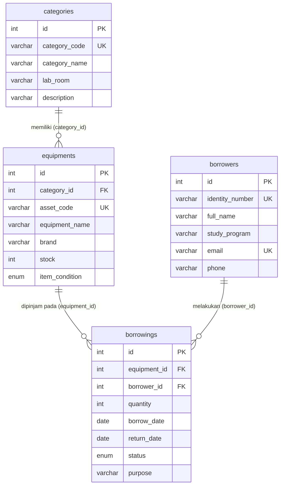
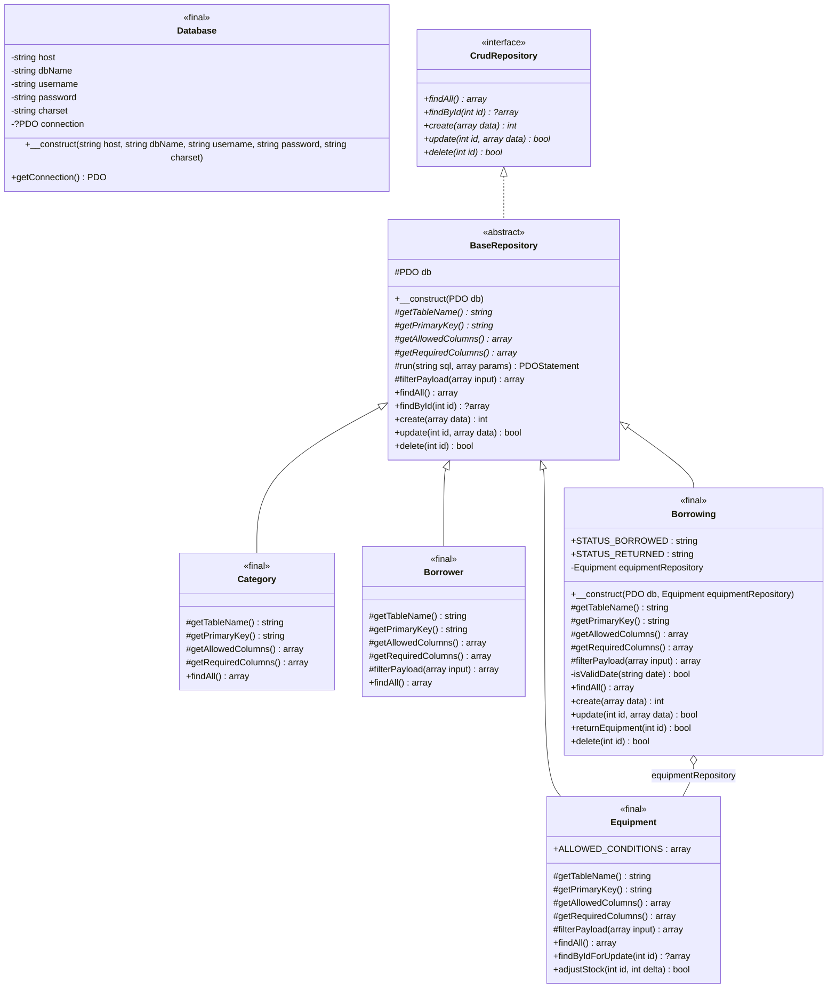
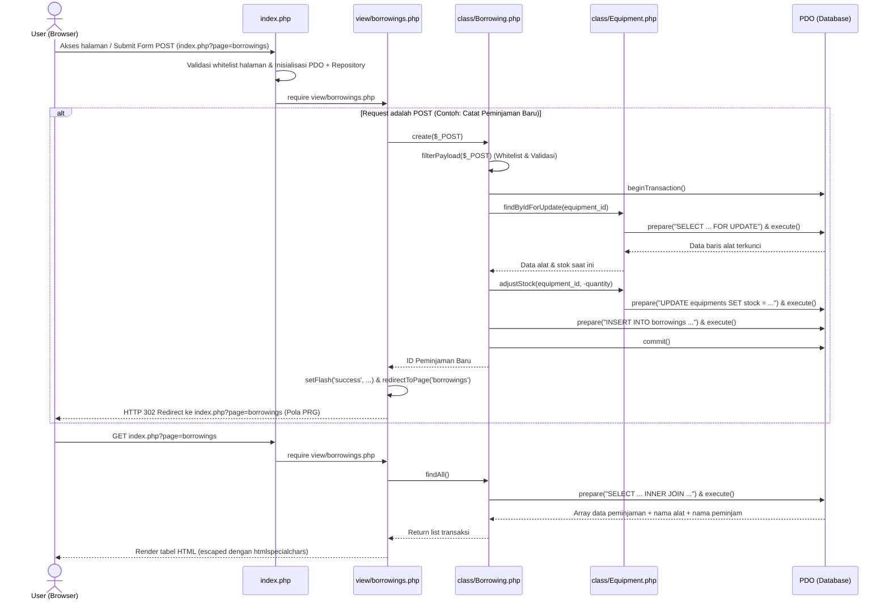

# TP7 DPBO — Sistem Manajemen Peminjaman Alat Laboratorium Komputer (LabGear)

Aplikasi web berbasis **PHP Native (OOP)** dengan **PDO Prepared Statement** untuk mengelola inventaris kategori alat, perangkat laboratorium, data peminjam, serta transaksi peminjaman dan pengembalian alat laboratorium secara real-time dan konsisten terhadap stok.

---

## Janji

> Saya **Muhammad Fadey Rafif** dengan NIM **2504792** mengerjakan Tugas Praktikum 7 dalam mata kuliah Desain dan Pemrograman Berorientasi Objek untuk keberkahanNya maka saya tidak melakukan kecurangan seperti yang telah dispesifikasikan. Aamiin.
---

## Tema Website & Daftar Fitur Utama

- **Tema Website**: Sistem Inventaris dan Peminjaman Alat Laboratorium Komputer (**LabGear Management System**).
- **Fitur Utama**:
  1. **CRUD Kategori Alat (`categories`)**: Mengelola kategori perangkat laboratorium beserta kode kategori, lokasi ruang lab, deskripsi, dan perhitungan otomatis jumlah jenis alat di tiap kategori.
  2. **CRUD Alat Laboratorium (`equipments`)**: Mengelola inventaris alat laboratorium yang berelasi ke tabel kategori (`category_id`), lengkap dengan kode aset unik, merek, jumlah stok tersedia, dan status kondisi alat (`Baik`, `Perlu Kalibrasi`, `Rusak Ringan`).
  3. **CRUD Data Peminjam (`borrowers`)**: Mengelola data mahasiswa/dosen/asisten peminjam beserta nomor identitas (NIM/NIP), program studi, email, nomor telepon, dan indikator jumlah pinjaman aktif.
  4. **CRUD Transaksi Peminjaman & Pengembalian (`borrowings`)**:
     - Mencatat peminjaman alat dengan relasi ke tabel `equipments` dan `borrowers`.
     - **Sinkronisasi Stok Otomatis & Transaksional**: Saat alat dipinjam, stok pada tabel `equipments` otomatis berkurang di dalam transaksi database (`beginTransaction`, `SELECT ... FOR UPDATE`, `commit`/`rollBack`).
     - **Tombol Kembalikan Cepat**: Mengubah status peminjaman dari `Dipinjam` menjadi `Dikembalikan`, mengisi tanggal kembali otomatis ke hari ini, dan mengembalikan stok alat.
     - **Proteksi Relasi & Validasi**: Menolak peminjaman jika stok tidak mencukupi dan menolak penghapusan data induk (`categories`, `equipments`, `borrowers`) yang masih digunakan oleh tabel anak (`ON DELETE RESTRICT`).

---

## Struktur Project

```text
TP7DPBO2526C1/
├── index.php                  # Titik awal aplikasi, whitelist router (?page=), & Dependency Injection
├── config/
│   ├── bootstrap.php          # Inisialisasi session, load config/helper, dan spl_autoload_register
│   ├── database.php           # Class Database untuk koneksi tunggal PDO (ERRMODE_EXCEPTION, EMULATE_PREPARES=false)
│   └── helpers.php            # Fungsi helper escape HTML e(), flash message PRG, redirect, & translasi error PDO
├── class/
│   ├── CrudRepository.php     # Interface kontrak dasar CRUD (findAll, findById, create, update, delete)
│   ├── BaseRepository.php     # Abstract class CRUD generik dengan PDO Prepared Statement & whitelist kolom
│   ├── Category.php           # Class entitas tabel categories
│   ├── Equipment.php          # Class entitas tabel equipments (+ penguncian baris & penyesuaian stok)
│   ├── Borrower.php           # Class entitas tabel borrowers
│   └── Borrowing.php          # Class entitas tabel borrowings (+ transaksi sinkronisasi stok)
├── view/
│   ├── header.php             # Elemen modular navigasi atas dan penampil flash message
│   ├── footer.php             # Elemen modular penutup halaman
│   ├── categories.php         # Halaman GUI form & tabel CRUD Kategori Alat
│   ├── equipments.php         # Halaman GUI form & tabel CRUD Alat Laboratorium
│   ├── borrowers.php          # Halaman GUI form & tabel CRUD Data Peminjam
│   └── borrowings.php         # Halaman GUI form & tabel CRUD Transaksi Peminjaman
├── style/
│   └── style.css              # Styling halaman responsif untuk form, tabel, badge, dan alert
├── database/
│   └── db_lab_gear.sql        # Struktur DDL 4 tabel (InnoDB, utf8mb4, FK) + data awal yang konsisten
├── docs/                      # Tempat menyimpan file screen record / screenshot dokumentasi
└── README.md                  # Dokumentasi lengkap proyek
```

---

## Database

### Entity-Relationship Diagram (ERD)



### Penjelasan Tabel dan Foreign Key

| Nama Tabel | Primary Key | Foreign Key & Aturan Relasi | Fungsi Tabel |
| :--- | :--- | :--- | :--- |
| `categories` | `id` | - | Menyimpan data kategori peralatan dan lokasi ruang laboratorium. |
| `equipments` | `id` | `category_id` -> `categories(id)` (`ON DELETE RESTRICT ON UPDATE CASCADE`) | Menyimpan daftar inventaris alat laboratorium, merek, kondisi, dan stok saat ini. |
| `borrowers` | `id` | - | Menyimpan data anggota peminjam (mahasiswa/dosen/asisten) beserta identitas dan kontak. |
| `borrowings` | `id` | `equipment_id` -> `equipments(id)` (`ON DELETE RESTRICT ON UPDATE CASCADE`)<br>`borrower_id` -> `borrowers(id)` (`ON DELETE RESTRICT ON UPDATE CASCADE`) | Menyimpan transaksi peminjaman alat, jumlah unit dipinjam, tanggal pinjam/kembali, status, dan keperluan. |

---

## Class Diagram & Prinsip OOP (SOLID)

### Class Diagram



### Alasan Pemilihan Kelas dan Atribut

| Nama Kelas | Alasan Pemilihan Kelas & Atribut |
| :--- | :--- |
| `Database` | Memisahkan konfigurasi dan pembuatan objek koneksi `PDO` (`$host`, `$dbName`, `$username`, `$password`, `$charset`, `$connection`) agar tidak tercampur dengan logika bisnis tabel. |
| `CrudRepository` | Menyediakan kontrak antarmuka standar (`findAll`, `findById`, `create`, `update`, `delete`) sehingga semua repository memiliki perilaku dasar yang seragam. |
| `BaseRepository` | Menghilangkan duplikasi kode CRUD pada setiap tabel. Menyimpan referensi `$db` (`PDO`) dan mengeksekusi seluruh query hanya melalui method `#run()` yang selalu memakai `prepare()` dan `execute()`, serta memvalidasi kolom lewat whitelist `#filterPayload()`. |
| `Category` | Mengontrol tabel `categories` dengan mendefinisikan whitelist kolom (`category_code`, `category_name`, `lab_room`, `description`) serta meng-override `findAll()` untuk menghitung jumlah jenis alat per kategori. |
| `Equipment` | Mengontrol tabel `equipments` dengan atribut kondisi yang diizinkan (`ALLOWED_CONDITIONS`), melakukan `INNER JOIN` ke `categories` pada `findAll()`, serta menyediakan `findByIdForUpdate()` dan `adjustStock()` untuk manipulasi stok yang aman dari balapan data (*race condition*). |
| `Borrower` | Mengontrol tabel `borrowers` dengan validasi format email serta menampilkan jumlah pinjaman aktif setiap peminjam. |
| `Borrowing` | Mengontrol tabel `borrowings` dan beragregasi dengan `Equipment` (`$equipmentRepository`) yang di-inject lewat constructor untuk mengelola transaksi peminjaman, pengembalian (`returnEquipment`), dan pemulihan stok dalam satu transaksi database. |

### Penerapan Prinsip SOLID

1. **Single Responsibility Principle (S)**:
   - `Database` hanya mengurus koneksi PDO.
   - `BaseRepository` hanya mengurus operasi CRUD generik dan prepared statement.
   - Class entitas (`Category`, `Equipment`, `Borrower`, `Borrowing`) masing-masing hanya mengurus aturan bisnis dan query spesifik tabelnya.
   - File di `view/` hanya mengurus tampilan HTML dan interaksi request/response.
2. **Open/Closed Principle (O)**:
   - Menambah entitas/tabel baru cukup dengan membuat class baru yang `extends BaseRepository` dan mendefinisikan nama tabel serta daftar kolom tanpa perlu mengubah kode di `BaseRepository`.
3. **Liskov Substitution Principle (L)**:
   - Seluruh subclass (`Category`, `Equipment`, `Borrower`, `Borrowing`) mematuhi kontrak signature parameter dan return type dari `CrudRepository` maupun `BaseRepository`.
4. **Interface Segregation Principle (I)**:
   - `CrudRepository` dirancang ringkas dan hanya memuat 5 operasi inti CRUD yang memang dibutuhkan oleh seluruh entitas.
5. **Dependency Inversion Principle (D)**:
   - Class repository tidak melakukan `new Database()` atau `new Equipment()` sendiri di dalam method-nya. Objek `PDO` dan `Equipment` di-inject dari luar (`index.php`) melalui constructor.

---

### Sequence Diagram



## Dokumentasi

> **TODO**: Letakkan file video screen record atau gif demonstrasi aplikasi di dalam folder `docs/` (misalnya `docs/demo.mp4` atau `docs/demo.gif`), lalu tautkan di bawah ini sebelum dikumpulkan.

